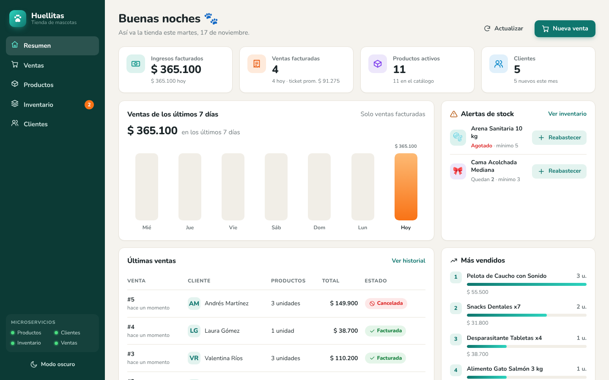
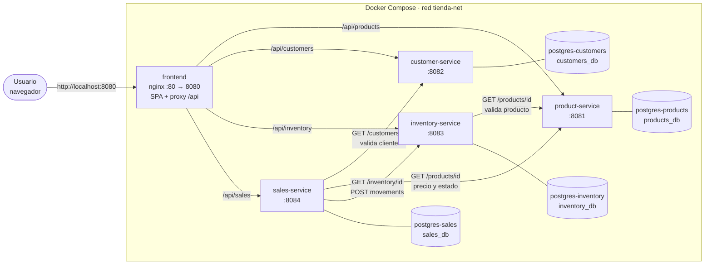
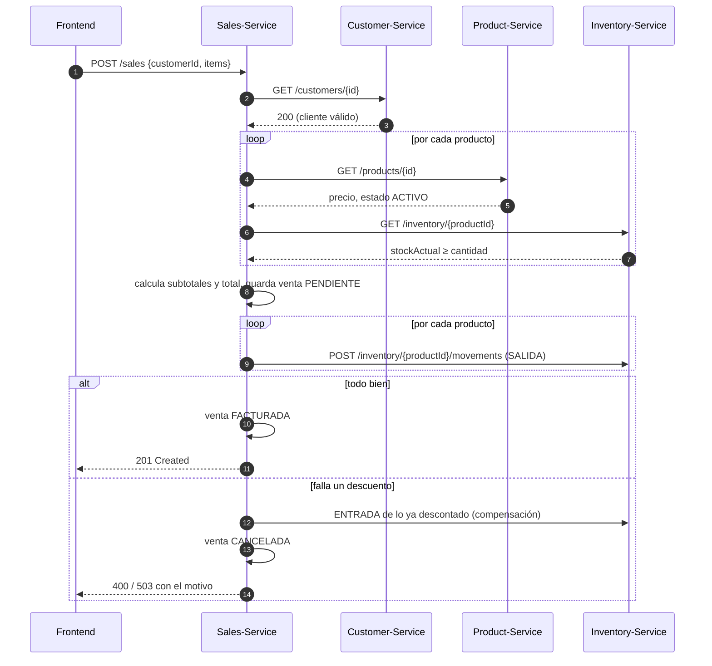

# Sistema de Gestión para una Tienda de Mascotas 🐾

Proyecto 6 - Programación II (Ingeniería de Sistemas). Plataforma distribuida para administrar
**productos, clientes, inventario y ventas** de una tienda de mascotas, construida con
**microservicios en Java 17 + Spring Boot 3**, una **base de datos PostgreSQL por servicio**,
**Docker Compose** y un **frontend web** ("Huellitas") que integra todo.



## Estado: Fases 1 a 5 completas

| Fase | Entregable | Estado |
|---|---|---|
| 1 | Product-Service (CRUD, reglas, Swagger) | ✅ |
| 2 | Customer-Service (CRUD, validaciones) | ✅ |
| 3 | Inventory-Service (existencias, movimientos, alertas, integración con Product) | ✅ |
| 4 | Sales-Service (flujo de venta con Customer, Product e Inventory) | ✅ |
| 5 | Pruebas unitarias + integración, Docker Compose completo, Postman, manuales, frontend | ✅ |

## Arquitectura



Cada microservicio es independiente: tiene su propio código, su propia base de datos y su propio
contenedor. Se comunican **solo por REST**; ningún servicio lee la base de datos de otro.

### Flujo de una venta



## Cómo ejecutarlo

### Con Docker (recomendado)

```bash
docker compose up --build -d
```

Cuando todos los contenedores estén `healthy` (1-2 minutos la primera vez):

| Qué | URL |
|---|---|
| **Aplicación web** | http://localhost:8080 |
| Swagger Product-Service | http://localhost:8081/swagger-ui.html |
| Swagger Customer-Service | http://localhost:8082/swagger-ui.html |
| Swagger Inventory-Service | http://localhost:8083/swagger-ui.html |
| Swagger Sales-Service | http://localhost:8084/swagger-ui.html |

En la primera pantalla de la aplicación aparece el botón **"Cargar datos de demostración"**, que crea
productos, clientes, existencias y algunas ventas pasando por las APIs reales.

Para detener: `docker compose down` (agregar `-v` para borrar también los datos).
Guía completa y solución de problemas: [docs/manual-despliegue.md](docs/manual-despliegue.md).

### Sin Docker (base de datos en memoria H2)

Abrir una terminal por servicio, en este orden (Inventory necesita a Product y Sales necesita a los otros tres):

```bash
cd product-service   && mvn spring-boot:run -Dspring-boot.run.profiles=h2
```
```bash
cd customer-service  && mvn spring-boot:run -Dspring-boot.run.profiles=h2
```
```bash
cd inventory-service && mvn spring-boot:run -Dspring-boot.run.profiles=h2
```
```bash
cd sales-service     && mvn spring-boot:run -Dspring-boot.run.profiles=h2
```

Y el frontend con cualquier servidor estático en el puerto 5500 (llama directo a los puertos 8081-8084):

```bash
cd frontend && python3 -m http.server 5500
```

Abrir http://localhost:5500

## Pruebas

| Tipo | Cantidad | Cómo ejecutarlas |
|---|---|---|
| Unitarias (servicio con Mockito) | 68 | `mvn test` en cada servicio |
| Integración por servicio (HTTP + JPA sobre H2, MockMvc) | 22 | `mvn test` en cada servicio (clases `*IntegrationTest`) |
| Integración de punta a punta (servicios reales, 5 casos del enunciado) | 22 verificaciones | `python3 integration-tests/e2e.py` con el sistema levantado |
| Colección Postman (mismos 5 casos, con tests automáticos) | 18 peticiones | [postman/](postman/) → Collection Runner o `newman` |
| Si te da error al intentar hacer las pruebas , puede que no tengas instalado MAVEN , pero puedes correrlas mediante este comando usando docker `foreach ($s in "product-service","customer-service","inventory-service","sales-service") { Write-Host "=== $s ==="; docker run --rm -v "${PWD}\${s}:/app" -v maven-repo:/root/.m2 -w /app maven:3.9-eclipse-temurin-17 mvn test }`|

Evidencias y resultados: [docs/evidencias/](docs/evidencias/README.md).

## APIs

### Product-Service (8081)
Reglas: código de barras único, precio no negativo, categoría y nombre obligatorios.
Categorías: `ALIMENTOS`, `MEDICAMENTOS`, `ACCESORIOS`, `JUGUETES`, `HIGIENE`.

| Método | Ruta | Descripción |
|---|---|---|
| GET | /products | Listar productos |
| GET | /products/{id} | Consultar un producto |
| POST | /products | Crear producto (201) |
| PUT | /products/{id} | Actualizar producto |
| DELETE | /products/{id} | Eliminar producto (204) |

### Customer-Service (8082)
Reglas: documento y correo únicos, nombre y teléfono obligatorios, formato de correo válido.

| Método | Ruta | Descripción |
|---|---|---|
| GET | /customers | Listar clientes |
| GET | /customers/{id} | Consultar un cliente |
| POST | /customers | Registrar cliente (201) |
| PUT | /customers/{id} | Actualizar cliente |
| DELETE | /customers/{id} | Eliminar cliente (204) |

### Inventory-Service (8083)
Reglas: no hay inventario de productos inexistentes (consulta a Product-Service), el stock nunca es
negativo, todos los movimientos quedan registrados y hay alerta cuando el stock baja del mínimo.

| Método | Ruta | Descripción |
|---|---|---|
| GET | /inventory | Listar el inventario |
| GET | /inventory/{productId} | Inventario de un producto |
| POST | /inventory | Registrar inventario de un producto (201) |
| PUT | /inventory/{id} | Actualizar stock y mínimo (registra un AJUSTE) |
| POST | /inventory/{productId}/movements | Registrar ENTRADA, SALIDA o AJUSTE |
| GET | /inventory/{productId}/movements | Historial de movimientos |
| GET | /inventory/alerts | Productos con stock bajo el mínimo |

### Sales-Service (8084)
Reglas: no hay ventas sin cliente válido ni sin stock (400), subtotales y total automáticos con el
precio actual, y el inventario se descuenta al registrar la venta (con compensación si algo falla).
Estados: `PENDIENTE`, `FACTURADA`, `CANCELADA`.

| Método | Ruta | Descripción |
|---|---|---|
| GET | /sales | Historial de ventas (más reciente primero) |
| GET | /sales/{id} | Venta con su detalle |
| POST | /sales | Registrar venta (201) |
| PUT | /sales/{id} | Cancelar venta (devuelve el stock si estaba facturada) |

```json
{ "customerId": 1, "items": [ { "productId": 1, "cantidad": 2 }, { "productId": 2, "cantidad": 1 } ] }
```

Todos los errores tienen el mismo formato:

```json
{ "timestamp": "...", "status": 400, "error": "Bad Request", "message": "Stock insuficiente para el producto 3: disponible 1, solicitado 5", "details": [] }
```

## Estructura del repositorio

```
├── product-service/      Fase 1 - catálogo
├── customer-service/     Fase 2 - clientes
├── inventory-service/    Fase 3 - existencias y movimientos
├── sales-service/        Fase 4 - ventas
├── frontend/             Interfaz web (HTML/CSS/JS sin dependencias) + nginx
├── integration-tests/    Pruebas de punta a punta (Fase 5)
├── postman/              Colección y entornos de Postman
├── docs/                 Manual técnico, manual de despliegue, evidencias y capturas
├── docker-compose.yml    4 servicios + 4 PostgreSQL + frontend
└── .env.example          Variables de entorno configurables
```

## Documentación

- [Manual técnico](docs/manual-tecnico.md)
- [Manual de despliegue](docs/manual-despliegue.md)
- [Evidencias de pruebas](docs/evidencias/README.md)

## Equipo

- Miguel Angel Barinas Vanegas
- Andrey Triana Torres
- Daniel Alejandro Rojas
