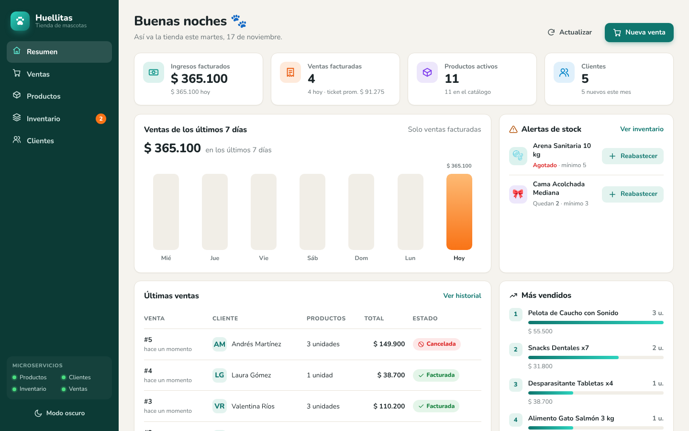
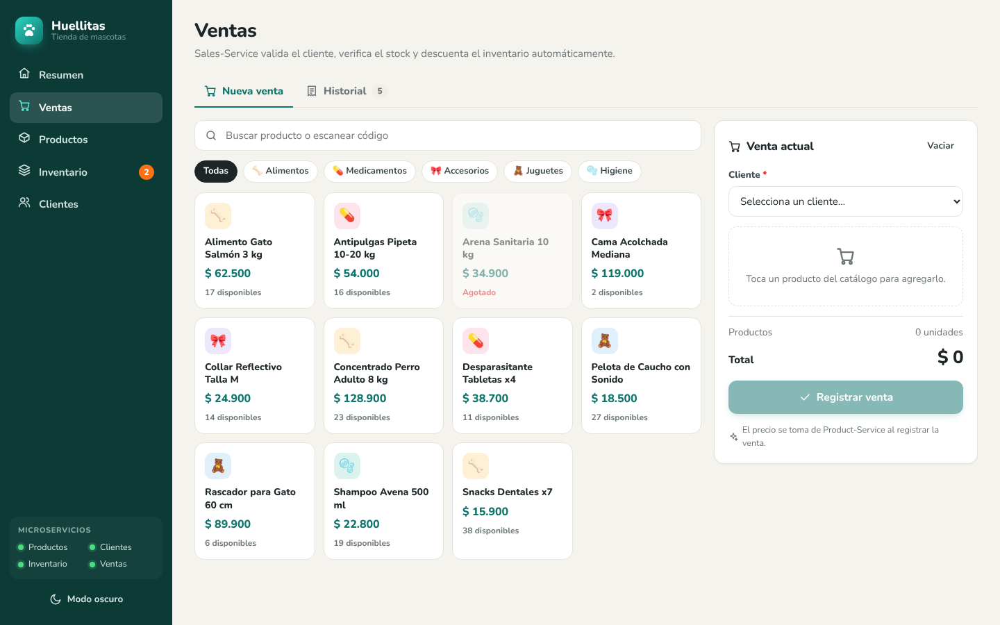
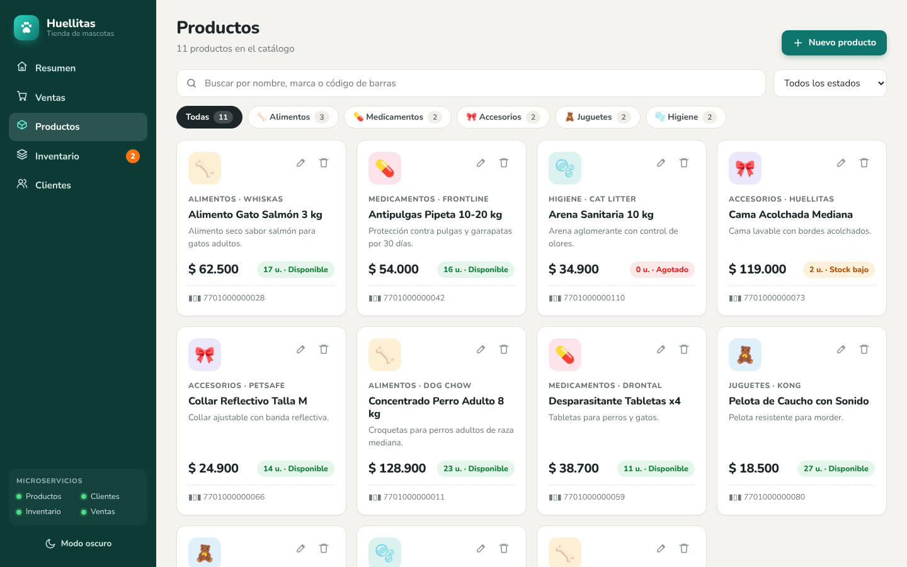
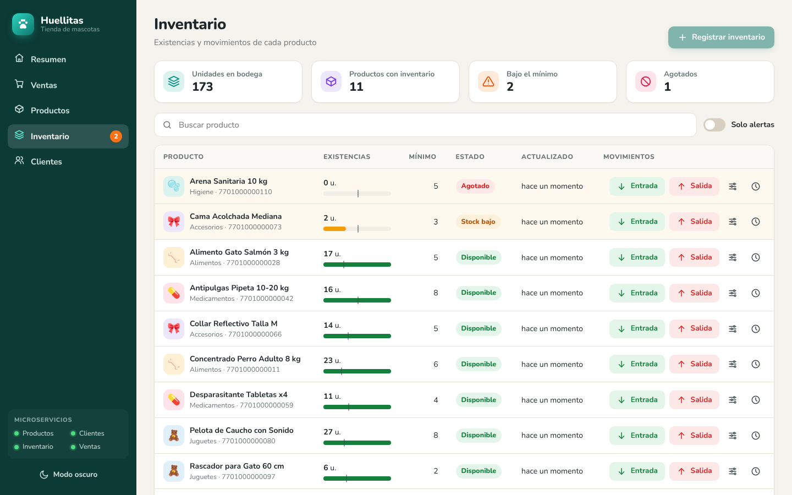
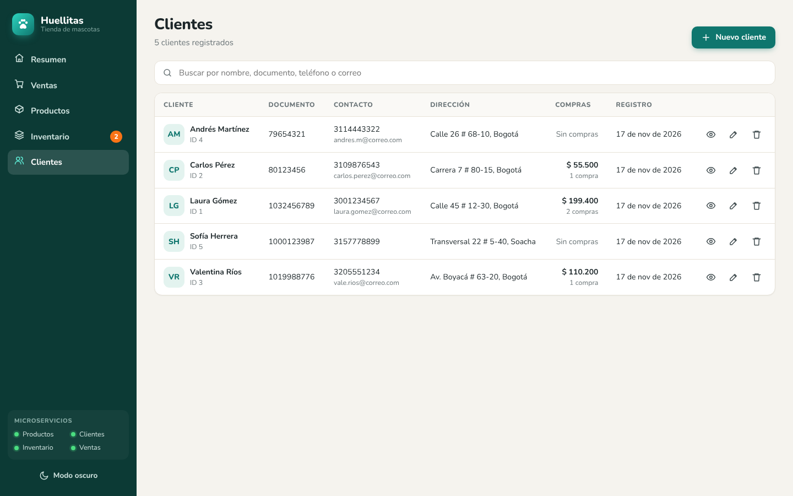
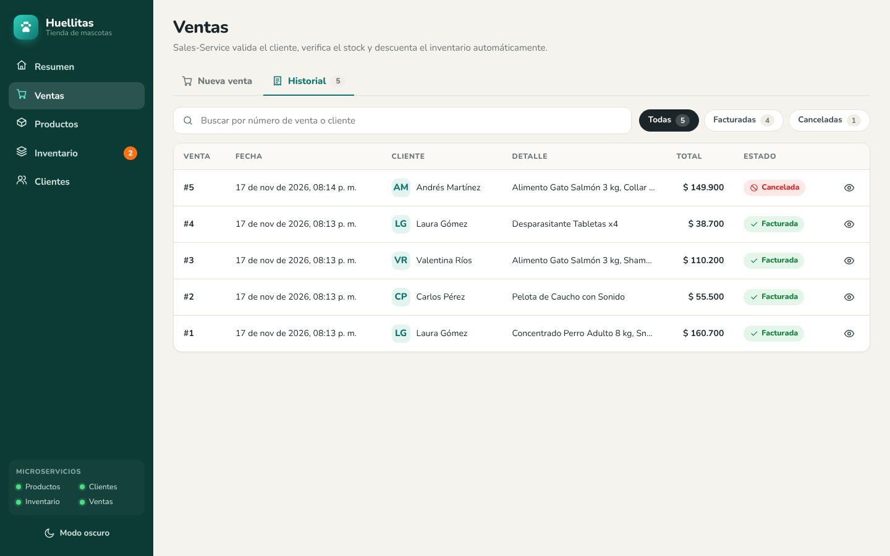
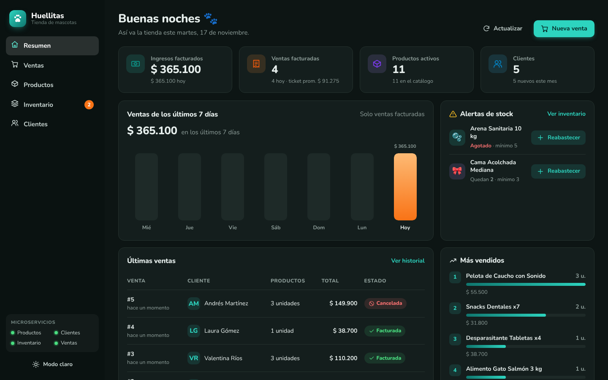
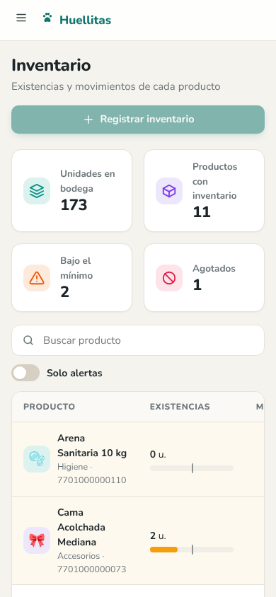

# Evidencias de pruebas (Fase 5)

## Resumen

| Prueba | Resultado | Archivo |
|---|---|---|
| Pruebas unitarias y de integración por servicio (JUnit 5, 90 pruebas) | ✅ 90/90 | [pruebas-junit.md](pruebas-junit.md) |
| Punta a punta contra los servicios reales, puertos directos | ✅ 22/22 verificaciones | [e2e-puertos-directos.md](e2e-puertos-directos.md) |
| Punta a punta a través del frontend (proxy nginx `/api`) | ✅ 22/22 verificaciones | [e2e-via-frontend.md](e2e-via-frontend.md) |

Las pruebas de punta a punta se ejecutaron con el sistema desplegado con `docker compose up`
(4 servicios + 4 PostgreSQL + frontend, todos `healthy`).

## Casos de integración del enunciado

| Caso | Qué se prueba | Resultado esperado | JUnit | E2E / Postman |
|---|---|---|---|---|
| 1 | Registrar un producto | HTTP 201 CREATED | `ProductIntegrationTest.caso1_registrarProducto_responde201` | Carpeta "Caso 1" |
| 2 | Agregar existencias (Inventory → Product) | Producto validado, inventario actualizado | `InventoryIntegrationTest.caso2_agregarExistencias` | Carpeta "Caso 2" |
| 3 | Registrar una venta (Sales → Customer → Inventory) | Cliente validado, stock verificado, venta registrada | `SaleIntegrationTest.caso3_registrarVenta` | Carpeta "Caso 3" |
| 4 | Vender un producto sin existencias | HTTP 400 BAD REQUEST | `SaleIntegrationTest.caso4_ventaSinExistencias_responde400` | Carpeta "Caso 4" |
| 5 | Consultar historial de ventas | Listado de ventas registradas | `SaleIntegrationTest.caso5_historialDeVentas` | Carpeta "Caso 5" |

En las pruebas JUnit de integración, los servicios externos se simulan con `@MockBean`. En la prueba
de punta a punta (`integration-tests/e2e.py`) y en la colección Postman, los cuatro servicios son reales.

## Pruebas unitarias pedidas por el enunciado

| Servicio | Pedido | Pruebas |
|---|---|---|
| Product | Crear, actualizar, consultar, eliminar | `crearProducto_*`, `actualizarProducto_*`, `consultarProducto*`, `eliminarProducto_*` |
| Customer | Registrar, actualizar, eliminar, consultar | `registrarCliente_*`, `actualizarCliente_*`, `eliminarCliente_*`, `consultarCliente*` |
| Inventory | Registrar existencias, actualizar stock, registrar movimientos | `registrarInventario_*`, `actualizarStock_*`, `movimientoDe*`, `ajuste_*`, `salidaMayorAlStock_*` |
| Sales | Crear ventas, calcular totales, actualizar inventario, gestionar errores | `registrarVenta_calculaSubtotalesYTotal_yDescuentaElInventario`, `registrarVenta_siFallaElInventario_*`, `cancelarVenta*` y otras |

## Cómo regenerar las evidencias

```bash
cd product-service && mvn test
```

(repetir en cada servicio; los reportes quedan en `target/surefire-reports/`)

```bash
docker compose up --build -d
```
```bash
python3 integration-tests/e2e.py --reporte docs/evidencias/e2e-puertos-directos.md
```
```bash
python3 integration-tests/e2e.py --gateway http://localhost:8080/api --reporte docs/evidencias/e2e-via-frontend.md
```

## Capturas del frontend

| | |
|---|---|
|  |  |
| Resumen | Nueva venta |
|  |  |
| Productos | Inventario |
|  |  |
| Clientes | Historial de ventas |
|  |  |
| Modo oscuro | Vista en celular |

## Guion sugerido para el video demostrativo

1. `docker compose up --build -d` y `docker compose ps` (9 contenedores, servicios `healthy`).
2. Abrir http://localhost:8080 y mostrar los cuatro microservicios en verde.
3. Cargar los datos de demostración y recorrer el Resumen.
4. Crear un producto con su stock inicial (Product + Inventory). Intentar repetir el código de barras → error 409.
5. Inventario: registrar una entrada y una salida, mostrar el historial y una alerta de stock bajo.
6. Ventas: armar un carrito, registrar la venta, mostrar el recibo y cómo bajó el stock.
7. Intentar vender más unidades de las disponibles → mensaje de stock insuficiente (400).
8. Cancelar una venta y mostrar que el stock vuelve al inventario.
9. Ejecutar `python3 integration-tests/e2e.py` (22/22) y mostrar Swagger de un servicio.
