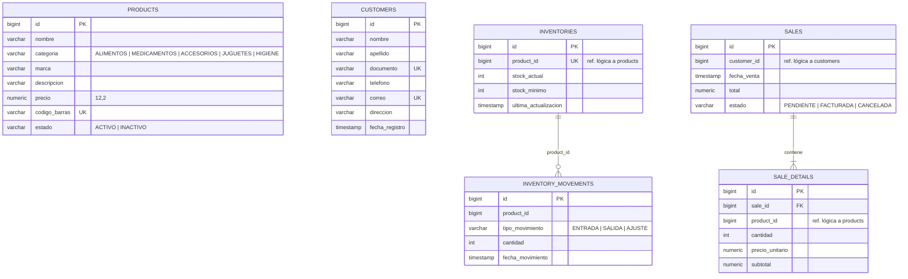

# Manual técnico

Sistema de gestión para una tienda de mascotas: arquitectura de microservicios.

## 1. Visión general

| Componente | Tecnología | Puerto | Base de datos |
|---|---|---|---|
| product-service | Java 17, Spring Boot 3.3 | 8081 | PostgreSQL `products_db` (5433) |
| customer-service | Java 17, Spring Boot 3.3 | 8082 | PostgreSQL `customers_db` (5434) |
| inventory-service | Java 17, Spring Boot 3.3 | 8083 | PostgreSQL `inventory_db` (5435) |
| sales-service | Java 17, Spring Boot 3.3 | 8084 | PostgreSQL `sales_db` (5436) |
| frontend | HTML, CSS y JavaScript (módulos ES) servidos por nginx 1.27 | 8080 | — |

Principios aplicados:

- **Una base de datos por servicio** (*database per service*). Las referencias entre dominios
  (`productId`, `customerId`) son identificadores lógicos, no llaves foráneas.
- **Comunicación síncrona REST** con `RestClient` de Spring, con tiempos de espera de 3 s (conexión)
  y 5 s (lectura) para no quedarse bloqueado si otro servicio no responde.
- **Arquitectura en capas** en cada servicio: `controller → service → repository → model`, con
  `dto` para entrada/salida (la entidad JPA nunca se expone) y `exception` para el manejo de errores.

El diagrama de arquitectura y el de secuencia de una venta están en el [README](../README.md#arquitectura).

## 2. Estructura de cada microservicio

```
src/main/java/com/tienda/<servicio>/
├── <Servicio>Application.java   punto de entrada Spring Boot
├── config/        OpenApiConfig (Swagger) y CorsConfig
├── controller/    endpoints REST (@RestController)
├── dto/           records de petición/respuesta con validaciones (jakarta.validation)
├── model/         entidades JPA y enums
├── repository/    interfaces Spring Data JPA
├── service/       reglas de negocio (@Service, @Transactional)
├── client/        clientes REST hacia otros servicios (solo inventory y sales)
└── exception/     excepciones de negocio + GlobalExceptionHandler + ApiError
src/main/resources/
├── application.properties      configuración con PostgreSQL (variables de entorno)
└── application-h2.properties   perfil "h2" con base de datos en memoria
src/test/java/...               pruebas unitarias (service/, dto/) e integración (integration/)
```

## 3. Modelo de datos



Cada grupo de tablas vive en una base de datos distinta: `products`, `customers`,
`inventories + inventory_movements` y `sales + sale_details`. Las tablas las crea Hibernate
(`spring.jpa.hibernate.ddl-auto=update`).

## 4. Reglas de negocio y dónde se implementan

| Regla | Dónde |
|---|---|
| Código de barras único | `ProductService.crear/actualizar` + `unique` en la columna |
| Precio no negativo, nombre y categoría obligatorios | `ProductRequest` (`@DecimalMin`, `@NotBlank`, `@NotNull`) |
| Documento y correo únicos (correo sin distinguir mayúsculas) | `CustomerService` + `unique` en las columnas |
| Nombre y teléfono obligatorios, formato de correo | `CustomerRequest` (`@NotBlank`, `@Pattern`) |
| No hay inventario de productos inexistentes | `InventoryService.crear` → `ProductClient.existe` (Product-Service) |
| Stock nunca negativo | `InventoryService.registrarMovimiento` (SALIDA) + `@Min(0)` en los DTO |
| Todos los movimientos quedan registrados | `InventoryService.registrar` en alta, PUT y cada movimiento |
| Alerta de stock bajo | `alertaStockBajo` en la respuesta, `GET /inventory/alerts` y log `WARN` |
| Ventas solo con cliente válido | `SaleService.crear` → `CustomerClient.existe` |
| Ventas solo con stock disponible | `SaleService.crear` → `InventoryClient.obtener` (y de nuevo al descontar) |
| Subtotales y total automáticos | `SaleService.crear`, con el precio actual de Product-Service (`BigDecimal`, redondeo HALF_UP) |
| Actualizar inventario después de registrar la venta | `SaleService.crear` → `InventoryClient.descontar` (movimiento SALIDA) |

## 5. Consistencia entre servicios

Como cada servicio tiene su propia base de datos, una venta no puede ser una única transacción ACID.
Se usa un esquema de **saga con compensación**:

1. La venta se guarda como `PENDIENTE` después de validar cliente, productos y stock.
2. Se descuenta el stock producto por producto (movimientos `SALIDA`).
3. Si todos los descuentos salen bien, la venta pasa a `FACTURADA`.
4. Si uno falla (por ejemplo, otra venta se llevó las últimas unidades o Inventory-Service se cayó),
   se devuelven con `ENTRADA` las unidades ya descontadas y la venta queda `CANCELADA` en el historial.

Cancelar una venta facturada (`PUT /sales/{id}`) hace lo contrario: repone el stock y, si la
reposición falla a medias, vuelve a descontar lo repuesto y la venta sigue `FACTURADA`.

Para que dos ventas simultáneas no descuenten el mismo stock, Inventory-Service bloquea la fila del
inventario (`PESSIMISTIC_WRITE`, `SELECT ... FOR UPDATE`) mientras aplica un movimiento o un PUT.

## 6. Manejo de errores

`GlobalExceptionHandler` traduce las excepciones a un JSON uniforme (`ApiError`):

| Excepción | HTTP |
|---|---|
| `MethodArgumentNotValidException` (validación de DTO) | 400, con `details` = `campo: mensaje` |
| `HttpMessageNotReadableException`, tipo de dato inválido | 400 |
| `BusinessRuleException` (regla de negocio, p. ej. sin stock) | 400 |
| `ResourceNotFoundException` | 404 |
| `DuplicateResourceException`, `DataIntegrityViolationException` | 409 |
| `ServiceUnavailableException` (otro microservicio no responde) | 503 |

## 7. Configuración

Variables de entorno (todas tienen un valor por defecto para desarrollo local):

| Variable | Servicios | Uso |
|---|---|---|
| `DB_URL`, `DB_USER`, `DB_PASSWORD` | todos | conexión a PostgreSQL |
| `PRODUCT_SERVICE_URL` | inventory, sales | URL base de Product-Service |
| `CUSTOMER_SERVICE_URL` | sales | URL base de Customer-Service |
| `INVENTORY_SERVICE_URL` | sales | URL base de Inventory-Service |
| `CORS_ALLOWED_ORIGINS` | todos | orígenes permitidos para el navegador (por defecto `*`) |
| `POSTGRES_USER`, `POSTGRES_PASSWORD`, `FRONTEND_PORT` | docker-compose | ver `.env.example` |

Cada servicio expone `GET /actuator/health`, que Docker Compose usa para esperar a que un servicio
esté listo antes de arrancar los que dependen de él.

## 8. Frontend

Aplicación de una sola página sin dependencias ni paso de compilación, en `frontend/`:

```
index.html          estructura (menú lateral, contenedor de vistas)
css/styles.css      diseño con variables CSS, modo claro/oscuro y responsive
js/config.js        URLs de las APIs (proxy /api con Docker, o puertos directos en desarrollo)
js/api.js           cliente HTTP: una función por endpoint y manejo de ApiError
js/ui.js            íconos, formato de moneda y fechas, toasts, modales y formularios
js/app.js           router por hash (#/productos, ...) y estado de los microservicios
js/demo.js          carga de datos de demostración a través de las APIs
js/views/*.js       una vista por pantalla: dashboard, products, customers, inventory, sales
```

Pantallas:

- **Resumen**: ingresos, ventas, productos y clientes, ventas de los últimos 7 días, alertas de stock
  (con botón para reabastecer), últimas ventas y productos más vendidos.
- **Ventas**: punto de venta (catálogo con stock en vivo, carrito, selección de cliente, lector de
  código de barras con Enter), recibo y historial con filtros y cancelación.
- **Productos**: catálogo con búsqueda y filtro por categoría y estado; al crear un producto también se
  registra su inventario inicial en Inventory-Service.
- **Inventario**: existencias con barra de stock frente al mínimo, entradas, salidas, ajustes, edición
  (PUT) e historial de movimientos.
- **Clientes**: CRUD con total comprado por cliente (cruce con Sales-Service).

En Docker, nginx sirve los archivos y reenvía `/api/products`, `/api/customers`, `/api/inventory` y
`/api/sales` a cada servicio por la red interna (`frontend/nginx.conf`), así el navegador habla con un
solo origen. Los errores de validación del backend se muestran debajo de cada campo del formulario.

## 9. Pruebas

| Nivel | Ubicación | Qué cubre |
|---|---|---|
| Unitarias | `*/src/test/java/.../service/*Test.java` | reglas de negocio con repositorios y clientes simulados (Mockito) |
| Validación de DTO | `*/src/test/java/.../dto/*ValidationTest.java` | anotaciones de validación |
| Integración por servicio | `*/src/test/java/.../integration/*IntegrationTest.java` | aplicación completa con `@SpringBootTest` + MockMvc + H2; los otros servicios se simulan con `@MockBean` |
| Punta a punta | `integration-tests/e2e.py` | los 5 casos del enunciado contra los 4 servicios reales |
| Postman | `postman/` | los mismos casos con tests automáticos en cada petición |

Resultados en [evidencias/](evidencias/README.md).
